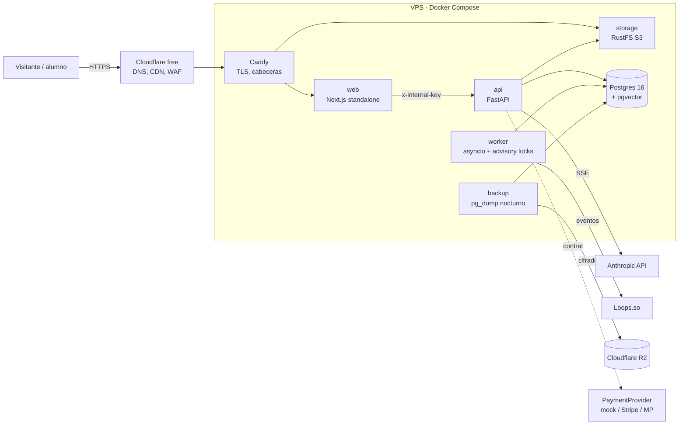
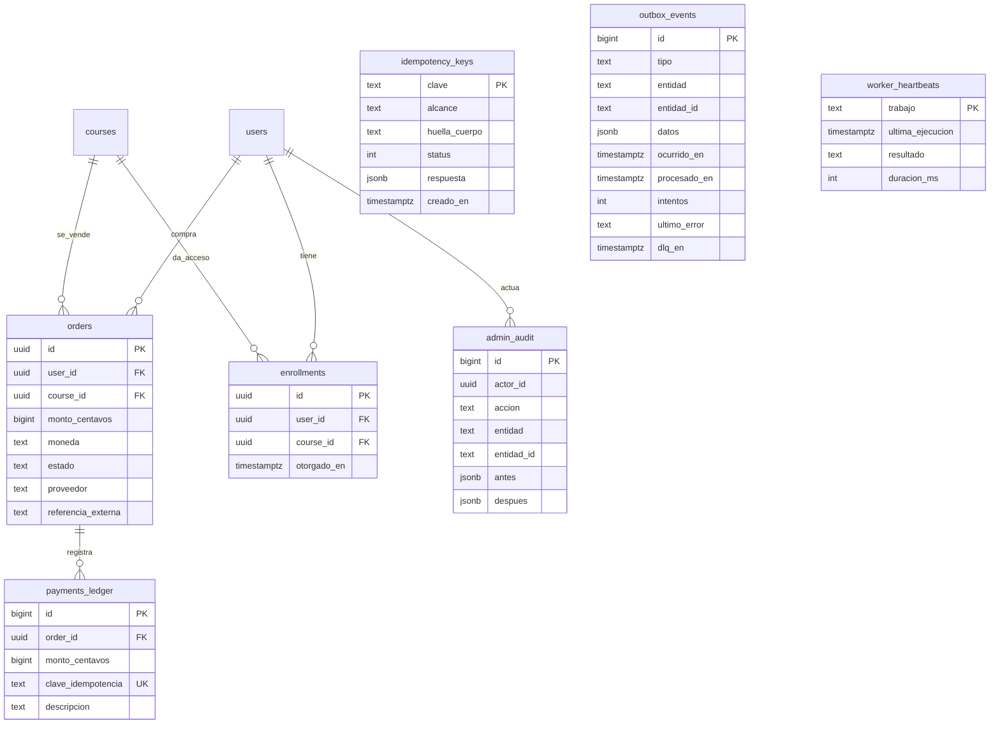

# CODEX AI Consulting — Architecture Blueprint v1 (plataforma v4)

> Basado en `docs/00-master-prompt.md`. Precios y límites de proveedores marcados `[VERIFICAR]`.
> Última revisión: 2026-10-20.

## 0. Resumen ejecutivo

- **Qué**: sitio de la agencia (servicios, proyectos anonimizados, academia, asistente RAG, contacto) más un portal para administrar cursos, leads y conocimiento, y la venta de cursos.
- **Stack**: Next.js 16 (App Router, Cache Components), FastAPI con Postgres 16 y pgvector, un worker en Python, almacenamiento S3 (RustFS), Caddy y Cloudflare free. Todo en **un VPS** con Docker Compose.
- **Costo mensual hoy**: el VPS `[VERIFICAR: ~10–20 USD por 4 GB de RAM]` más el consumo de Claude (variable; con tope).
- **Riesgo #1**: el VPS es un punto único de falla (SPOF). Se mitiga con backups nocturnos fuera del servidor (R2), una restauración probada y un RTO documentado de menos de 2 h.

## 1. Supuestos

| Supuesto | Valor | Impacto si es falso |
|---|---|---|
| Tráfico | 300 visitas/día hoy, 2 000/día a 24 meses | 10x sigue cabiendo; a 100x hay que mover la web al CDN o a un edge |
| Alumnos | < 500 a 24 meses | Más alumnos solo requieren más storage y egress de video |
| Consultas al asistente | ≤ 200/día | Es el costo variable principal; se protege con rate limit y un tope de gasto en Anthropic |
| Equipo | 1 persona (Diego) | Cualquier operación tiene que poder hacerse con un `docker compose` y un runbook |
| Presupuesto | Solo VPS + Claude | Si sube, el primer gasto es Postgres gestionado con PITR |
| Pagos | Mock hasta tener llaves de prueba | Sin llaves no se cobra; el adaptador real falla de forma explícita |

## 2. Requisitos

**Funcionales (MVP)**
- Como prospecto, quiero entender qué hace CODEX y ver proyectos reales, para agendar un diagnóstico.
- Como prospecto, quiero preguntarle al asistente y que me cite sus fuentes, para resolver dudas sin esperar.
- Como prospecto, quiero dejar mis datos una sola vez (aunque dé doble clic), para que me contacten.
- Como alumno, quiero comprar un curso y ver sus lecciones, para aprender a mi ritmo.
- Como admin, quiero editar cursos y subir video o PDF, y revisar leads y la base de conocimiento.

**No funcionales**

| Métrica | Objetivo |
|---|---|
| Disponibilidad (sitio) | 99.5 % mensual (~3.6 h de caída permitida) |
| LCP p75 | < 2.5 s |
| CLS | < 0.1 |
| INP | < 200 ms |
| Latencia de la API p95 (sin chat) | < 300 ms |
| Primer token del chat | < 2 s |
| RPO | 24 h (dump nocturno); 1 h cuando haya pagos reales (WAL archiving, F-futura) |
| RTO | < 2 h (VPS nuevo + restauración) |
| Consistencia | Fuerte en órdenes, ledger e inscripciones; eventual (≤ 2 min) en el envío a Loops.so |
| Retención | Leads 24 meses; auditoría indefinida; backups 14 días |

**Restricciones**: LFPDPPP, español (México), accesibilidad AA, `prefers-reduced-motion` y cero nombres de clientes.

## 3. Estimación de capacidad (24 meses)

- **Peticiones**: 2 000 visitas/día × 6 páginas = 12 000 páginas/día ≈ 0.14 req/s de promedio. Con un pico de 10x, **≈ 1.4 req/s**. Una instancia sobra.
- **Lecturas y escrituras**: más del 99 % son lecturas, servidas en su mayoría desde la caché de Next. Las escrituras son leads (~20/día), eventos y órdenes.
- **Storage de base de datos**: leads 20/día × 1 KB × 730 días ≈ 15 MB. Fragmentos RAG ≈ 5 000 × (384 × 4 B + 1 KB) ≈ 13 MB. **Total < 200 MB.**
- **Storage de objetos**: el video domina. 10 cursos × 3 h × ~500 MB/h ≈ 15 GB.
- **Egress**: imágenes 4K servidas como AVIF responsivo, ~300 KB por página → 12 000 × 0.3 MB ≈ 3.6 GB/día ≈ 108 GB/mes. Cloudflare los cachea en el borde. Video: 500 alumnos × 1 GB/mes = 500 GB/mes. **Aquí está el disparador hacia R2** `[VERIFICAR: R2 no cobra egress]`.
- **Conexiones a Postgres**: api (pool de 10) + worker (pool de 3) + backup (1) < 20.
- **RAM**: Postgres 512 MB + api con fastembed ~900 MB + web ~250 MB + worker ~150 MB + RustFS ~200 MB + Caddy 50 MB ≈ **2.1 GB → VPS de 4 GB**.

**Conclusión**: cabe en una sola instancia con holgura.

## 4. Diagramas



```mermaid
sequenceDiagram
  participant B as Navegador
  participant W as Next BFF /api/leads
  participant A as FastAPI /leads
  participant D as Postgres
  participant K as Worker
  participant L as Loops.so
  B->>W: POST lead (Idempotency-Key: uuid)
  W->>A: POST /leads + clave + x-internal-key
  A->>D: BEGIN; insert idempotency_keys (on conflict)
  alt clave nueva
    A->>D: insert leads + insert outbox_events; COMMIT
    A-->>W: 201 {id}
  else clave repetida, mismo cuerpo
    A-->>W: 201 con la respuesta guardada
  end
  W-->>B: "Mensaje recibido."
  loop cada 15 s (advisory lock)
    K->>D: select ... for update skip locked
    K->>L: lead_created
    K->>D: procesado_en = now() | intentos++ / DLQ
  end
```

## 5. Decisiones por capa

| # | Capa | Decisión | Alternativa descartada | Costo hoy | Trampa | Disparador de upgrade |
|---|---|---|---|---|---|---|
| 01 | Cómputo | Contenedores de larga vida en el VPS (web, api, worker) | Vercel (Hobby prohíbe uso comercial; Pro `[VERIFICAR ~20 USD]`) | VPS | Tú eres el SRE | CPU p95 > 70 % durante 1 semana → VPS más grande |
| 02 | API | REST sobre FastAPI, OpenAPI automático, errores `{error:{codigo,…}}`, `Idempotency-Key` en POST con efecto | GraphQL/tRPC (un solo cliente, no lo justifica) | 0 | Romper el BFF al cambiar el formato de error | Cliente móvil → prefijo `/v1` |
| 03 | Base de datos | Postgres 16 + pgvector en contenedor, Alembic | Supabase (reescribir auth y storage sin necesidad; D-002) | 0 | Sin PITR | Primer pago real → WAL archiving o Postgres gestionado |
| 04 | Caché | `'use cache'` + `cacheLife` + `cacheTag` en Next; Cloudflare para estáticos | Redis (no hay un problema que lo justifique) | 0 | Contenido viejo tras publicar | Invalidación por `revalidateTag` desde el portal |
| 05 | Tiempo real | SSE solo en el chat | WebSockets (unidireccional, no hace falta) | 0 | Buffering del proxy | Ya resuelto con `flush_interval -1` |
| 06 | Colas y jobs | Outbox en Postgres + worker propio (`python -m app.worker`, asyncio, `pg_try_advisory_lock` por trabajo) con `skip locked`, backoff exponencial con jitter y DLQ a los 8 intentos | Redis/QStash/SQS | 0 | El worker caído retrasa los emails | Backlog > 1 000 o latencia > 5 min → alerta |
| 07 | Red y borde | Cloudflare free (DNS, CDN, WAF básico) → Caddy (TLS) | Load balancer gestionado | 0 | Reglas WAF limitadas | Ataque sostenido → Cloudflare Pro `[VERIFICAR]` |
| 08 | Despliegue | Docker Compose + `git pull && compose up -d --build` | Kubernetes (1 nodo, 1 persona) | 0 | Despliegue manual | > 1 despliegue/día → GitHub Actions con SSH |
| 09 | Estilo | Monolito modular (routers + services) + worker | Microservicios | 0 | — | ≥ 2 equipos |
| 10 | Observabilidad | Logs JSON (structlog) con `traceId`, `/health` con latido, UptimeRobot externo `[VERIFICAR free]` | Stack Grafana self-hosted | 0 | Retención corta de logs de Docker | Primer incidente sin datos → Grafana Cloud free |
| 11 | Auth | JWT propio (access 15 min + refresh 24 h) en cookies httpOnly vía BFF; roles admin/editor/student | Clerk/Supabase Auth | 0 | Sin MFA | Más de 1 admin → TOTP |
| 12 | Archivos | RustFS S3 + URLs prefirmadas | Supabase Storage | 0 | Egress de video desde el VPS | > 300 GB/mes → R2 |
| 13 | Seguridad | Llave interna web→api, rate limit, CSP y cabeceras, RLS en tablas de dinero, auditoría inmutable | — | 0 | XFF falsificable (se corrige en F3) | — |
| 14 | CI/CD | GitHub Actions: lint, tipos, pytest con Postgres de servicio, build, e2e | — | 0 `[VERIFICAR minutos en repos privados]` | Minutos limitados | Agotar los minutos → runner self-hosted |
| 15 | Notificaciones | Loops.so (eventos `lead_created`, `course_interest`, `order_paid`) | SMTP propio | 0 `[VERIFICAR free]` | Dominio sin SPF/DKIM/DMARC | — |
| 16 | IA/LLMs | Claude (Opus) por SSE, RAG con fastembed local + FTS + RRF; modo demo sin llave | Embeddings de pago | Por token `[VERIFICAR]` | Abuso del chat | Gasto > tope → modelo más barato como fallback |
| 17 | Backups y DR | `pg_dump -Fc` nocturno → R2, 14 días, restauración probada con un script | Snapshots del VPS solamente | 0 `[VERIFICAR R2 10 GB free]` | Backup nunca probado | Pagos reales → RPO 1 h |
| 18 | Costos | Ver `docs/costos.md` | — | — | — | Alertas de facturación en Anthropic y en el VPS |

## 6. Modelo de datos

Existente (migración 0001): `users`, `courses`, `modules`, `lessons`, `leads`, `documents`, `chunks`.

Nuevo (migración 0002, F3/F4):



- `payments_ledger` y `admin_audit`: un trigger `app.impedir_modificacion()` bloquea UPDATE y DELETE.
- RLS en `orders`, `enrollments` y `payments_ledger`: `user_id = current_setting('app.user_id', true)::uuid OR current_setting('app.role', true) = 'admin'`. La API fija ambos valores con `set_config(..., true)` en cada transacción. El rol de la app no es dueño de las tablas (sin BYPASSRLS).
- Índices: `outbox_events (id) where procesado_en is null and dlq_en is null`, `orders (user_id)`, `enrollments (user_id, course_id) unique`.

## 7. Contrato de API

| Método | Ruta | Auth | Idempotencia | Errores |
|---|---|---|---|---|
| GET | `/health` | ninguna | — | 503 si db no responde |
| POST | `/auth/login`, `/auth/refresh` · GET `/auth/me` | — / refresh / access | — | `CREDENCIALES_INVALIDAS`, `TOKEN_INVALIDO` |
| POST | `/leads` | llave interna | `Idempotency-Key` | `VALIDACION`, `IDEMPOTENCIA_CONFLICTO`, `DEMASIADAS_SOLICITUDES` |
| POST | `/chat` (SSE) | llave interna | — | `DEMASIADAS_SOLICITUDES` |
| GET | `/courses`, `/courses/{slug}` | llave interna (+ alumno opcional) | — | `NO_ENCONTRADO` |
| POST | `/checkout` | alumno | `Idempotency-Key` | `CURSO_NO_DISPONIBLE`, `PROVEEDOR_NO_CONFIGURADO` |
| POST | `/payments/webhook/{proveedor}` | firma del proveedor | `referencia_externa` única | `FIRMA_INVALIDA` |
| `*` | `/admin/*` | admin/editor | — | `NO_AUTORIZADO`, `PROHIBIDO` |

Formato de error: `{"error": {"codigo": "VALIDACION", "mensaje": "…", "detalles": {...}, "traceId": "…"}}`. Cada respuesta lleva `x-trace-id`.

## 8. Integraciones

| Sistema | Modo | Justificación |
|---|---|---|
| Anthropic | En vivo (SSE) con timeout, y modo demo sin llave | La respuesta es por petición; no hay nada que replicar |
| Loops.so | Asíncrono vía outbox | Una caída de Loops no puede perder ni bloquear leads |
| Pasarela de pago | Contrato `PaymentProvider` + mock; el real falla sin llaves | Ver `docs/integracion-pagos.md` |
| Storage S3 | En vivo con URLs prefirmadas | El navegador sube directo; la API solo firma |

## 9. Seguridad y compliance

- [x] Llave interna web→api; la api no es pública (solo la llama el contenedor web).
- [x] JWT en cookies httpOnly; refresh de 24 h.
- [ ] (F3) `forwarded-allow-ips` limitado a la red de Docker o a Caddy.
- [ ] (F3) Errores sin trazas internas; logs sin datos personales (el email se registra con hash).
- [ ] (F4) RLS en tablas de dinero, con prueba automática.
- [ ] (F3) Auditoría inmutable de acciones admin.
- [ ] (F5) Cabeceras en Caddy (HSTS, nosniff, Referrer-Policy) además de las de Next.
- [ ] (F5) Backups cifrados (`age`) con restauración probada y fechada.
- [ ] Aviso de privacidad LFPDPPP y canal ARCO (PENDIENTE: el texto legal lo valida el cliente).
- [x] Nunca tarjetas en la BD: tokenización de la pasarela.

## 10. Observabilidad

- Logs JSON con `traceId`, `ruta`, `status` y `duracion_ms`; en el worker: `trabajo`, `ejecucionId`, `resultado`.
- `/health` devuelve `{db, storage, worker:{latido_hace_s}, outbox:{pendientes, dlq}, version}`.

**Alertas** (UptimeRobot sobre `/health` + monitor de palabra clave):

| Condición | Umbral |
|---|---|
| Latido detenido | > 120 s |
| Eventos en DLQ | > 0 |
| Pendientes en el outbox | > 500 |
| Sitio caído | 2 chequeos seguidos (cada 5 min) |
| Gasto en Anthropic | > 80 % del tope mensual (alerta del proveedor) |

## 11. Costos

Ver `docs/costos.md`.

## 12. Riesgos

| Riesgo | Prob. | Impacto | Mitigación |
|---|---|---|---|
| Caída o pérdida del VPS (SPOF) | Media | Alto | Backup fuera del servidor, restauración probada, runbook de RTO < 2 h |
| Abuso del chat → factura de Claude | Media | Medio | Rate limit, tope de gasto en Anthropic, `max_tokens`, modo demo |
| Animaciones pesadas → LCP/INP malos | Media | Medio | Hero visible sin JS, GSAP diferido, presupuesto en Lighthouse en la revisión |
| Exposición de clientes en contenido | Baja | Alto | Regla `sameClient`, revisión de cada proyecto, cifras redondeadas |
| Backup que no restaura | Media | Alto | `restore-test.sh` mensual con fecha registrada |

## 13. ADRs

Ver la tabla en `CLAUDE.md` (D-001 en adelante).

## 14. Plan de 5 fases

Ver `docs/checklist-lanzamiento.md`.

**Primeras 10 tareas**:
1. Tokens y fuentes nuevos.
2. Infraestructura de motion.
3. CI.
4. Fotos aprobadas.
5. Header y hero.
6. Secciones de la home.
7. Páginas interiores.
8. Contrato de errores.
9. Outbox y worker.
10. Migración 0002.

## 15. Estructura del repositorio

```
apps/web/        Next.js (src/app/(site), src/app/portal, src/components/{home,motion,portal}, src/lib)
apps/api/        FastAPI (app/routers, app/services, app/worker.py, alembic, tests)
content/         site.json, services.json, projects.json, cases.json, credits.json
infra/           docker-compose.prod.yml, Caddyfile, .env.prod.example, scripts/{backup,restore-test}.sh
docs/            00-master-prompt.md, arquitectura.md, costos.md, checklist-lanzamiento.md, plan-pruebas.md, integracion-pagos.md
.github/         workflows/ci.yml, dependabot.yml
```

## 16. Pendientes

- Foto y años de experiencia de Diego.
- Llaves de prueba de Stripe y/o Mercado Pago.
- Proveedor y plan del VPS.
- Dominio y acceso a Cloudflare.
- Cuenta R2.
- Presupuesto mensual tope.
- Deadline.
- Texto del aviso de privacidad.
